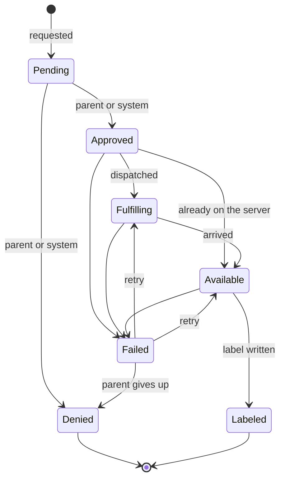

# Requests

A request is a kid profile asking for a movie or show. Requests are stored in the `MediaRequests` table and every change of state is recorded in `MediaRequestEvents`. `MediaRequests` in `Wishlistarr.Api.Requests` creates requests and moves them between states; the transition table itself is `RequestStateMachine` in `Wishlistarr.Core.Requests` and does no I/O. Kids ask for titles through `POST /api/v1/kid/requests` (see [Asking for a title](#asking-for-a-title)) and see their own list through `GET /api/v1/kid/requests` (see [Kid wishlist](#kid-wishlist)).

## States



| State | Meaning |
| --- | --- |
| `Pending` | Waiting for a decision. |
| `Approved` | Allowed, not yet sent anywhere. |
| `Denied` | Turned down. |
| `Fulfilling` | Sent off to be downloaded. |
| `Available` | On the media server. |
| `Labeled` | The kid's Plex label is on the item. |
| `Failed` | Dispatch, arrival or labeling went wrong. |

`Denied` and `Labeled` are final.

## Actors

Every change is made by an actor: a `Kid` (with the kid profile id), a `Parent` (with the parent account id, or none for the API key) or the `System` (with the name of the component, such as `dispatch`). Each transition lists who may make it:

| From | To | Actors |
| --- | --- | --- |
| `Pending` | `Approved`, `Denied` | Parent, System |
| `Approved` | `Fulfilling`, `Available`, `Failed` | System |
| `Fulfilling` | `Available`, `Failed` | System |
| `Available` | `Labeled`, `Failed` | System |
| `Failed` | `Fulfilling`, `Available` | Parent, System |
| `Failed` | `Denied` | Parent |

The System may approve or deny so that content policy can decide a request without a parent. Kids can create requests for their own profile and cannot move them. Parents and the System can create requests for any active profile.

## Transitions

`TransitionAsync(requestId, to, actor, reason)` returns one of:

- `Changed`: the state moved and an event was stored.
- `Unchanged`: the request was already in that state. Nothing is stored, so repeating a transition is safe.
- `Rejected`: the transition is not in the table, or the actor may not make it. The request is left as it was.
- `NotFound`: there is no such request.

The state change and its event are saved together. Each request has a `Version` that is checked and bumped on every change, so when two writers race only one wins; the other reads the request again and is decided against its new state, which usually makes it `Unchanged` or `Rejected`.

`RetryAsync(requestId, actor, reason)` moves a failed request back to the step that failed: `Available` if labeling failed, otherwise `Fulfilling`. Retrying a request that has already been retried is `Unchanged`.

## Duplicates

A kid can only have one open request per title. Titles are identified by kind (`Movie` or `Show`) and TMDB id, like the content policy's `TitleKey`. `CreateAsync` for a title the profile already has a request for, in any state but `Denied`, returns `Merged` with the existing request instead of creating another, and bumps its `RequestCount` and `LastRequestedAt`. A merge is not a transition and stores no event.

Once a request is denied, asking again starts a new `Pending` request; the denied one stays in the history. A unique index on profile, kind and TMDB id (ignoring denied requests) keeps this true when two requests arrive at once.

## History

Each `MediaRequestEvents` row holds the request id, the state before (empty for the creation) and after, the actor's kind, id and name, an optional reason of up to 500 characters and the time it happened. Rows are only ever added. `GetHistoryAsync(requestId)` returns them oldest first.

## Asking for a title

`POST /api/v1/kid/requests` needs a Kid session and the antiforgery token, and takes `{ kind, tmdbId }` where `kind` is `movie` or `show`. `KidRequestFlow` in `Wishlistarr.Api.Requests` handles it in this order:

1. The title's name, genres, original language and US certification are read from TMDB. When the profile blocks keywords, the title's keywords are read too (`keywords` on a movie, `results` on a show). The content policy is then evaluated for the profile. Nothing is looked up in Plex and no label is written before this. A keyword lookup that fails or times out refuses the request. A lookup that returns no keywords is not a match. A profile with no keyword blocks does not call the keywords endpoint.
2. A `Blocked` title is turned away with `422` and a message meant for a kid (`"That one isn't available."`, `code: "notAllowed"`). The rating, genre, keyword, language and the reason are not shown to the kid; the reason code is written to the log. No request is stored.
3. An `Allowed` title is looked for in the library by its TMDB id. If it is there, the request is created and moved by the System (`instant-label`) through `Approved` to `Available`, then the profile's Plex label is added to every matching item with the label writer (source `request`) and the request becomes `Labeled`. It never goes to `Fulfilling`, so nothing is downloaded. If Plex will not take the label, or the item has gone, the request becomes `Failed` and can be retried.
4. Everything else becomes a `Pending` request: titles that need approval, even when they are already in the library (they are not labeled), and allowed titles that are not in the library. Until approval rules exist, a parent decides every pending request.

A new request answers `201` and asking again for a title that already has a request answers `200`; both return `{ id, kind, tmdbId, title, state, requestCount }`. Unknown titles answer `404`, and when TMDB cannot be reached the answer is `502` (or `503` without an API key) with a message that is safe to show a kid.

### Library lookup

The library is checked through `LibraryLookup`, which asks each registered `ILibraryIndex` first. An index returns the matching items, or `null` when it cannot answer yet, for example before its first sync. With no index, or when none can answer, the flow falls back to a live lookup on the Plex server (`IMediaServer.FindByExternalIdAsync`). If Plex is not connected or cannot be reached, the title is treated as not in the library, so it becomes a pending request and is never labeled.

### Double submission

Asking twice for the same title gives one request: the second ask is a merge (see [Duplicates](#duplicates)), it bumps `requestCount` and does not label again. Allowance checks, the duplicate check and the creation of the request run in one database transaction, and SQLite lets only one such transaction write at a time, so taps that arrive together are handled one after the other.

### Weekly allowance

A profile's `weeklyAllowance` limits how many new requests it can make in a week. Without one there is no limit; `0` means no new requests.

- Weeks start on Monday at midnight in the parent's time zone. Set it with the `parent.time_zone` setting to an IANA name such as `America/Chicago` (`PUT /api/v1/settings/parent.time_zone`; unknown names are rejected). Without the setting the server's time zone is used. When a clock change skips midnight the week starts at the first time that exists, and when midnight happens twice it starts at the first one.
- Every new request the kid creates counts once, whatever happens to it later, including denied ones.
- Instant labels do not count and are not blocked by the allowance: the title is already on the server and the policy allowed it, so nothing is downloaded and no parent has to act.
- Asking again for a title that already has a request does not count.
- A request over the allowance is answered with `429`, `code: "allowanceUsed"` and `resetsAt`, the start of the next week. Nothing is stored.

Each request stores whether it counts in `CountsTowardAllowance`, so the rule that applied when it was made is kept.

## Kid wishlist

`GET /api/v1/kid/requests` needs a Kid session. It answers for the signed-in profile only. There is no profile id to pass, and a query string is ignored. A kid never receives another profile's requests. A parent session is rejected with `403`, and a caller who is not signed in as a kid with `401`. The response is `Cache-Control: private, no-store`.

```json
{
  "remaining": 2,
  "resetsAt": "2026-10-26T05:00:00+00:00",
  "items": [
    {
      "id": 1,
      "kind": "movie",
      "tmdbId": 700,
      "title": "Movie 700",
      "state": "waiting",
      "note": null,
      "plex": null
    }
  ]
}
```

`remaining` is how many new requests the profile can still make this week, using the same week and the same `CountsTowardAllowance` count as [Weekly allowance](#weekly-allowance). It is `null` when the profile has no `weeklyAllowance` (no limit). `resetsAt` is the start of the next week when there is a limit, and `null` otherwise. `0` wishes left means the allowance is used up or was set to `0`.

Items are the profile's own requests, newest first. The stored title is returned as text. Nothing is read from TMDB for this list.

### Friendly states

The internal state is not returned. Each item has one of four labels:

| Internal state | `state` | What the kid sees |
| --- | --- | --- |
| `Pending`, `Failed` | `waiting` | Waiting for a parent |
| `Approved`, `Fulfilling` | `onTheWay` | On its way |
| `Available`, `Labeled` | `ready` | Ready to watch |
| `Denied` | `denied` | Not this time |

`Failed` is shown as waiting for a parent because a parent is who can retry it or decide it is not this time. A state the server does not recognise is left off the list.

### Denial note

When the request was denied by a parent, `note` is that parent's reason, trimmed, as plain text. The web app renders it as text and never as HTML. A denial by the system, a blank reason, or any reason on a request that is not denied is not included. Other event reasons, actor names, and the internal state are not in the response.

### Opening a ready title in Plex

A ready item has `plex` only when the selected server's machine identifier is known and the library index can name the item. The identifier and the rating key must be a short token of letters, digits, `_` and `-` (the same limits as the stored server id and rating key). If the index cannot answer yet, the item is not in the index, the lookup fails, or either value is not that shape, `plex` is `null`. The list does not ask Plex itself, and it never includes a server address or a token.

`plex.webUrl` opens the item in the hosted Plex Web app. [Opening Plex Web App](https://support.plex.tv/articles/200288666-opening-plex-web-app/) documents `https://app.plex.tv/desktop` as that app. The item path is the one Plex Web puts in the address bar, `#!/server/<machineIdentifier>/details?key=/library/metadata/<ratingKey>`, with the key percent-encoded so the whole thing is one URL. That shape is what the web app uses, as described in the Plex forum thread [Supported deep link to a specific library item's detail page](https://forums.plex.tv/t/supported-deep-link-to-a-specific-library-items-detail-page-on-android-mobile-and-windows-desktop/944608) (October 2026).

`plex.appUrl` uses the `plex://` scheme: `plex://preplay/?metadataKey=%2Flibrary%2Fmetadata%2F<ratingKey>&metadataType=<type>&server=<machineIdentifier>`. `metadataType` is `1` for a movie and `2` for a show. The movie value is the one in that October 2026 example, and the same `1` movie / `2` show numbering is what a Plex employee gave for the metadata match API in [Android universal linking](https://forums.plex.tv/t/android-universal-linking-watch-plex-tv-links/932340). There is no support article for the `plex://` parameters. The same October 2026 thread notes that some current app builds open Home instead of the item, and that the desktop app does not take these links. The web link is the one that opens the detail page. Neither link carries `X-Plex-Token` or the server's own address.

The page uses the URLs from this response as the link targets. It accepts a web link only when it starts with `https://app.plex.tv/` and an app link only when it starts with `plex://`, and it drops either one that contains `X-Plex-Token` or a `:32400` port. A ready title with no accepted link still shows "Ready to watch".

### Keeping the list current

The kid home polls `GET /api/v1/kid/requests` every 15 seconds while the tab is visible. A failed load waits 30 seconds, then 60, and stays at 60 until a load works again. While the tab is hidden the timer is cleared, and showing the tab loads the list at once. The page does not reload.

Polling is the fit for this app. The wishlist is one small JSON document behind the cookie session the kid already has, and a parent decision or a download is not second-critical. Server-sent events would hold a connection open, and nothing else in the API streams. Polling stops in the background and slows down when the server is unhappy, without a second way to authenticate.
