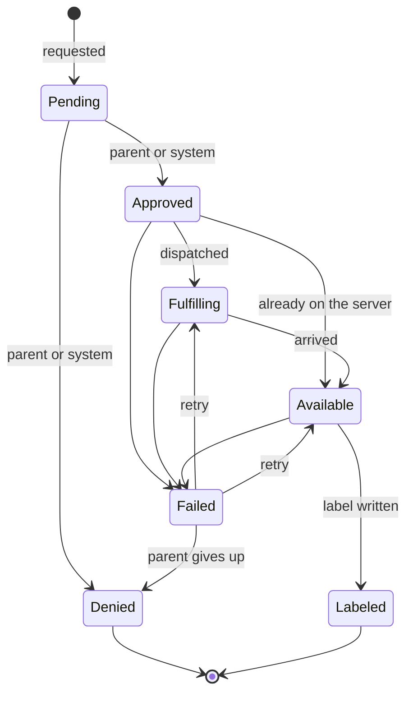

# Requests

A request is a kid profile asking for a movie or show. Requests are stored in the `MediaRequests` table and every change of state is recorded in `MediaRequestEvents`. `MediaRequests` in `Wishlistarr.Api.Requests` creates requests and moves them between states; the transition table itself is `RequestStateMachine` in `Wishlistarr.Core.Requests` and does no I/O. There is no endpoint for requests yet.

## States

| State | Meaning |
| --- | --- |
| `Pending` | Waiting for a decision. |
| `Approved` | Allowed, not yet sent anywhere. |
| `Denied` | Turned down. |
| `Fulfilling` | Sent off to be downloaded. |
| `Available` | On the media server. |
| `Labeled` | The kid's Plex label is on the item. |
| `Failed` | Dispatch, arrival or labeling went wrong. |

`Denied` and `Labeled` are final.

## Actors

Every change is made by an actor: a `Kid` (with the kid profile id), a `Parent` (with the parent account id, or none for the API key) or the `System` (with the name of the component, such as `dispatch`). Each transition lists who may make it:

| From | To | Actors |
| --- | --- | --- |
| `Pending` | `Approved`, `Denied` | Parent, System |
| `Approved` | `Fulfilling`, `Available`, `Failed` | System |
| `Fulfilling` | `Available`, `Failed` | System |
| `Available` | `Labeled`, `Failed` | System |
| `Failed` | `Fulfilling`, `Available` | Parent, System |
| `Failed` | `Denied` | Parent |

The System may approve or deny so that content policy can decide a request without a parent. Kids can create requests for their own profile and cannot move them. Parents and the System can create requests for any active profile.

## Transitions

`TransitionAsync(requestId, to, actor, reason)` returns one of:

- `Changed`: the state moved and an event was stored.
- `Unchanged`: the request was already in that state. Nothing is stored, so repeating a transition is safe.
- `Rejected`: the transition is not in the table, or the actor may not make it. The request is left as it was.
- `NotFound`: there is no such request.

The state change and its event are saved together. Each request has a `Version` that is checked and bumped on every change, so when two writers race only one wins; the other reads the request again and is decided against its new state, which usually makes it `Unchanged` or `Rejected`.

`RetryAsync(requestId, actor, reason)` moves a failed request back to the step that failed: `Available` if labeling failed, otherwise `Fulfilling`. Retrying a request that has already been retried is `Unchanged`.

## Duplicates

A kid can only have one open request per title. Titles are identified by kind (`Movie` or `Show`) and TMDB id, like the content policy's `TitleKey`. `CreateAsync` for a title the profile already has a request for, in any state but `Denied`, returns `Merged` with the existing request instead of creating another, and bumps its `RequestCount` and `LastRequestedAt`. A merge is not a transition and stores no event.

Once a request is denied, asking again starts a new `Pending` request; the denied one stays in the history. A unique index on profile, kind and TMDB id (ignoring denied requests) keeps this true when two requests arrive at once.

## History

Each `MediaRequestEvents` row holds the request id, the state before (empty for the creation) and after, the actor's kind, id and name, an optional reason of up to 500 characters and the time it happened. Rows are only ever added. `GetHistoryAsync(requestId)` returns them oldest first.
