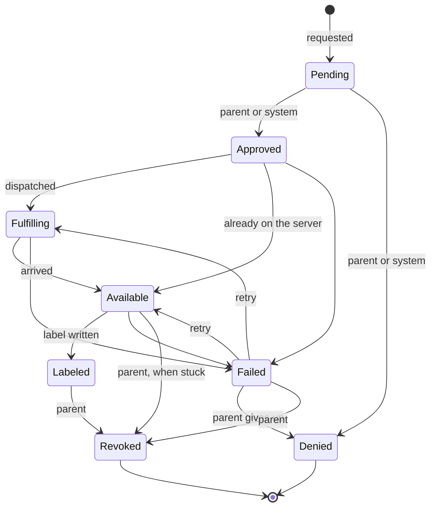

# Requests

A request is a kid profile asking for a movie or show. Requests are stored in the `MediaRequests` table and every change of state is recorded in `MediaRequestEvents`. `MediaRequests` in `Wishlistarr.Api.Requests` creates requests and moves them between states; the transition table itself is `RequestStateMachine` in `Wishlistarr.Core.Requests` and does no I/O. Kids ask for titles through `POST /api/v1/kid/requests` (see [Asking for a title](#asking-for-a-title)).

## States

| State | Meaning |
| --- | --- |
| `Pending` | Waiting for a decision. |
| `Approved` | Allowed, not yet sent anywhere. |
| `Denied` | Turned down. |
| `Fulfilling` | Sent off to be downloaded. |
| `Available` | On the media server. |
| `Labeled` | The kid's Plex label is on the item. |
| `Failed` | Dispatch, arrival or labeling went wrong. |
| `Revoked` | A parent took the app's label back. The title stays in the history. |

`Denied` and `Revoked` are final. `Labeled` is not: a parent can revoke it. A parent can also revoke a `Failed` request, because labeling has finished before a request is marked `Failed`, and an `Available` request that has been stuck there for longer than `Approval:StuckAfter`. An `Available` request inside that time is not revoked, because its label may still be being written. See [Granting and revoking](#granting-and-revoking).

## Actors

Every change is made by an actor: a `Kid` (with the kid profile id), a `Parent` (with the parent account id, or none for the API key) or the `System` (with the name of the component, such as `dispatch`). Each transition lists who may make it:

| From | To | Actors |
| --- | --- | --- |
| `Pending` | `Approved`, `Denied` | Parent, System |
| `Approved` | `Fulfilling`, `Available`, `Failed` | System |
| `Fulfilling` | `Available`, `Failed` | System |
| `Available` | `Labeled`, `Failed` | System |
| `Available` | `Revoked` | Parent |
| `Labeled` | `Revoked` | Parent |
| `Failed` | `Fulfilling`, `Available` | Parent, System |
| `Failed` | `Denied`, `Revoked` | Parent |

The System may approve or deny so that content policy can decide a request without a parent. Kids can create requests for their own profile and cannot move them. Parents and the System can create requests for any active profile.

## Transitions

`TransitionAsync(requestId, to, actor, reason)` returns one of:

- `Changed`: the state moved and an event was stored.
- `Unchanged`: the request was already in that state. Nothing is stored, so repeating a transition is safe.
- `Rejected`: the transition is not in the table, or the actor may not make it. The request is left as it was.
- `NotFound`: there is no such request.

The state change and its event are saved together. Each request has a `Version` that is checked and bumped on every change, so when two writers race only one wins; the other reads the request again and is decided against its new state, which usually makes it `Unchanged` or `Rejected`.

`RetryAsync(requestId, actor, reason)` moves a failed request back to the step that failed: `Available` if labeling failed, otherwise `Fulfilling`. Retrying a request that has already been retried is `Unchanged`.

## Duplicates

A kid can only have one open request per title. Titles are identified by kind (`Movie` or `Show`) and TMDB id, like the content policy's `TitleKey`. `CreateAsync` for a title the profile already has a request for, in any state but `Denied`, returns `Merged` with the existing request instead of creating another, and bumps its `RequestCount` and `LastRequestedAt`. A merge is not a transition and stores no event. A parent grant creates its request with merging turned off: when the profile already has an open request for the title, `CreateAsync` returns `Unchanged` with that request and changes nothing on it.

Once a request is denied or revoked, asking again starts a new `Pending` request; the closed one stays in the history. A unique index on profile, kind and TMDB id (ignoring denied and revoked requests) keeps this true when two requests arrive at once. A title that has been revoked is not decided by the content policy or an auto-approve rule the next time the kid asks: it waits for a parent. See [Granting and revoking](#granting-and-revoking).

## History

Each `MediaRequestEvents` row holds the request id, the state before (empty for the creation) and after, the actor's kind, id and name, an optional reason of up to 500 characters and the time it happened. Rows are only ever added. `GetHistoryAsync(requestId)` returns them oldest first.

## Asking for a title

`POST /api/v1/kid/requests` needs a Kid session and the antiforgery token, and takes `{ kind, tmdbId }` where `kind` is `movie` or `show`. `KidRequestFlow` in `Wishlistarr.Api.Requests` handles it in this order:

1. The title's name, genres, original language and US certification are read from TMDB. When the profile blocks keywords, the title's keywords are read too (`keywords` on a movie, `results` on a show). The content policy is then evaluated for the profile. Nothing is looked up in Plex and no label is written before this. A keyword lookup that fails or times out refuses the request. A lookup that returns no keywords is not a match. A profile with no keyword blocks does not call the keywords endpoint.
2. A `Blocked` title is turned away with `422` and a message meant for a kid (`"That one isn't available."`, `code: "notAllowed"`). The rating, genre, keyword, language and the reason are not shown to the kid; the reason code is written to the log. No request is stored.
3. An `Allowed` title is looked for in the library by its TMDB id. If it is there, the request is created and moved by the System (`instant-label`) through `Approved` to `Available`, then the profile's Plex label is added to every matching item with the label writer (source `request`) and the request becomes `Labeled`. It never goes to `Fulfilling`, so nothing is downloaded. If Plex will not take the label, or the item has gone, the request becomes `Failed` and can be retried. A label already added to another copy is taken off again first (see [Approving and denying](#approving-and-denying)).
4. An auto-approve rule can decide the rest without a parent. It uses the same approval path as a parent, and the actor is the system (`auto-approve`). See [Auto-approve](#auto-approve).
5. Anything the rule does not approve stays `Pending`: titles that need approval, including every unrated title, even when they are already in the library (they are not labeled until a parent approves), and allowed titles that are not in the library and that the rule does not approve.

A new request answers `201` and asking again for a title that already has a request answers `200`; both return `{ id, kind, tmdbId, title, state, requestCount }`. Unknown titles answer `404`, and when TMDB cannot be reached the answer is `502` (or `503` without an API key) with a message that is safe to show a kid.

### Library lookup

The library is checked through `LibraryLookup`, which asks each registered `ILibraryIndex` first. An index returns the matching items, or `null` when it cannot answer yet, for example before its first sync. With no index, or when none can answer, the flow falls back to a live lookup on the Plex server (`IMediaServer.FindByExternalIdAsync`). If Plex is not connected or cannot be reached, the title is treated as not in the library, so it becomes a pending request and is never labeled.

### Double submission

Asking twice for the same title gives one request: the second ask is a merge (see [Duplicates](#duplicates)), it bumps `requestCount` and does not label again. Allowance checks, the duplicate check and the creation of the request run in one database transaction, and SQLite lets only one such transaction write at a time, so taps that arrive together are handled one after the other.

### Weekly allowance

A profile's `weeklyAllowance` limits how many new requests it can make in a week. Without one there is no limit; `0` means no new requests.

- Weeks start on Monday at midnight in the parent's time zone. Set it with the `parent.time_zone` setting to an IANA name such as `America/Chicago` (`PUT /api/v1/settings/parent.time_zone`; unknown names are rejected). Without the setting the server's time zone is used. When a clock change skips midnight the week starts at the first time that exists, and when midnight happens twice it starts at the first one.
- Every new request the kid creates counts once, whatever happens to it later, including denied ones.
- Instant labels do not count and are not blocked by the allowance: the title is already on the server and the policy allowed it, so nothing is downloaded and no parent has to act.
- Asking again for a title that already has a request does not count.
- A request over the allowance is answered with `429`, `code: "allowanceUsed"` and `resetsAt`, the start of the next week. Nothing is stored.

Each request stores whether it counts in `CountsTowardAllowance`, so the rule that applied when it was made is kept.

## Approving and denying

Parents decide pending requests. A kid session cannot.

- `GET /api/v1/requests` lists requests in id order, one page at a time, as `{ items, total, limit, offset }`. `?state=pending` (or any other state name) limits the list. A number is not a state name. `limit` is 1 to 200 (default 50) and `offset` is 0 or more; anything else is rejected with `400`. `total` counts every request that matches the state and has a kid profile, the same rows the list can return, so a client can tell when more remain. Each item has `canRevoke`: true for a `Labeled` request, for a `Failed` request when the ownership ledger still holds a label for the profile on one of the title's copies, and for an `Available` request that has been there for longer than `Approval:StuckAfter`. For the failed requests on a page, `canRevoke` comes from one read of the library index and one ledger query, matched by server, Plex guid and profile; it never calls Plex. Until the index has finished its first full sync it cannot answer, and every failed request has `canRevoke` false. The count and the page are read in one transaction. Titles are resolved once per page, not once per row.
- `POST /api/v1/requests/approve` and `POST /api/v1/requests/deny` take `{ ids, reason }`. `ids` is required, from 1 to 50 positive ids. `reason` is optional. The web app sends a longer selection as several calls of at most 50 and lists every item that did not succeed.

Both writes need the Parent role and, for a session cookie or the trusted-network bypass, the antiforgery token. An API key does not send one. Each id comes back on its own in `{ results: [{ id, status, state }] }`. `status` is one of:

| Status | Meaning |
| --- | --- |
| `succeeded` | This call applied the decision. |
| `alreadyDecided` | The request was already approved (or further along) for an approve call, or already denied for a deny call. Nothing was written. |
| `notFound` | There is no such request. |
| `notProcessed` | The call ran past its overall deadline before this id was reached. Nothing was written for it; send it again. |
| `failed` | The decision could not be applied. The request is left as it was, except when labeling an in-library title fails for any reason: that request moves to `Failed`. |
| `conflict` | The request was no longer pending because someone chose the other outcome, or it had already failed. A deny only applies to a request that is still pending, so it cannot take a failed approval. |

A batch that is empty, too long, or contains an id that is not positive is rejected with `400` and nothing is changed. The same is true of a reason that is longer than 500 characters after trimming. Calling either endpoint again is safe: a request that was already given that decision is `alreadyDecided`, and a label is not written a second time.

Approving a title the library lookup does not find moves it from `Pending` to `Approved` and stops. Sending it to Sonarr, Radarr or Seerr is a later step. Approving a title the lookup finds moves it to `Approved`, then `Available`, writes the profile's Plex label through the label writer and the ownership ledger (source `request`), and then moves it to `Labeled`. If the label cannot be written, or the item has gone, or the label writer fails in any other way, the request moves to `Failed` instead of `Labeled`; a failure that the application can see never leaves it at `Available`. Writing the label has a deadline of `Approval:LabelTimeout` (default 30 seconds); a Plex call that does not answer in time ends that request as `Failed` with the reason `Plex did not answer in time.`. A call with many ids also has an overall deadline, `Approval:BulkTimeout` (default 5 minutes, never shorter than `LabelTimeout`). Ids not reached by then come back as `notProcessed` and stay as they were. A third value, `Approval:StuckAfter` (default 10 minutes, longer than `LabelTimeout`), is how long a request has to sit at `Available` before a parent can revoke it. All three are set under the `Approval` configuration section as `hh:mm:ss` values. `LabelTimeout` is at most 10 minutes and `BulkTimeout` at most 24 hours, and the application will not start if a value is invalid. The moves after `Approved` are not tied to the caller's connection, so a caller that disconnects cannot leave an in-library title at `Approved`. Instant labels use the same labeling code. It never goes to `Fulfilling`.

The ownership row is saved before the label is sent to Plex, in its own save that the deadline cannot cancel. If Plex rejects the write, the row is removed again. If the deadline fires while Plex is answering, the row stays, so a label that Plex did apply is always owned and can be removed later. The reverse can happen: a `Failed` request from a timeout may have a label in Plex, or a row for a label Plex never applied, and removing it later reports the label as not present and clears the row. A label that was already on the item before the request is never given a row.

A title can have more than one copy in the library, and the label goes on each of them in turn. If a later copy fails, for any of the reasons above, the labels this attempt added to earlier copies are removed again before the request moves to `Failed`, so a failed request normally leaves no label of its own behind. A label that was already on a copy before the attempt is not touched. If removing one of them fails too, that label stays on the copy with its ledger row, the error is logged, and the parent page offers to revoke the failed request, which removes it. The copy whose own write failed is handled by the label writer: if Plex rejected the write, its new row is removed again; if Plex did not answer in time, the row stays whether or not the label arrived, and the parent page offers to revoke the failed request, which removes the label or clears the row.

Labeling, revoking and the labeling part of a grant take a lock for the request, so for one request only one of them runs at a time in the application. Labeling checks that the request is still `Available` once it holds the lock and writes nothing otherwise. Waiting for the lock ends when the caller goes away. For labeling, the request is already `Available` by then, so it moves to `Failed` with the reason `Labeling was stopped before it started.` and no label is written.

One gap remains. If the database fails or the process stops after the request was moved to `Available` and before the final move to `Labeled` or `Failed`, the request stays at `Available` and nothing moves it on its own. There is no automatic repair. The title is in the library, and the Plex label may or may not have been written. Once the request has been at `Available` for longer than `Approval:StuckAfter`, the parent list marks it with `canRevoke` and the parent page offers to revoke it. That removes any labels the ledger shows for the profile on the title's copies and moves the request to `Revoked`. Granting it again in the meantime is `409`.

The library lookup is the same one requests already use. A ready library index answers, and an empty answer means the title is not in the library even if a live Plex scan would find it. An index that cannot answer yet falls back to Plex. If the lookup throws, the approval fails and the request stays `Pending`: nothing is labeled and nothing is marked approved.

The `Pending` to `Approved` or `Denied` event records who acted. A signed-in parent is stored with the account id and username. An API key is stored as a parent named `API key` with no account id, and a trusted-network caller as a parent named `Trusted network` with no account id, which is how those callers already sign in. Later steps (`Available`, `Labeled`, `Failed`) are the system (`approval`), unless the actor was already the system. Two decisions for the same request cannot both succeed. The request version lets one save win; the other comes back as `alreadyDecided` or `conflict`, and only the winner labels.

## Denial reasons

`reason` is trimmed. A blank reason is stored as nothing. Otherwise it is stored as plain text on the `Pending` to `Denied` event, up to 500 characters, and it is not interpreted as HTML. The kid sees it only from `GET /api/v1/kid/requests`, and only on that kid's own denied requests, as `denialReason`. Other states omit it, including a failed request, so a labeling error is not shown to the kid. The list has no actor name and no other profile's requests. The parent list can include the same text.

## Auto-approve

Each profile has a switch, `autoApprove`, and an optional movie ceiling and TV ceiling (`autoApproveMovieRating`, `autoApproveTvRating`). The ceilings are rating levels (`preschool`, `general`, `children`, `parentalGuidance`, `teen`, `mature`, `adult`). A missing ceiling is no ceiling. Anything else is rejected. See [kid profiles](kid-profiles.md) for how they are saved, and [content policy](content-policy.md) for how a level relates to a certification.

Auto-approve never approves a title without a known rating. An unrated title always stays `Pending` for a parent, whatever the switch or the ceilings say and whether or not the title is already in the library. A ceiling, when set, always caps auto-approval, whether or not the switch is on, and movies and TV have separate ceilings. With the switch on and no ceiling for that kind, every title the content policy allows and that has a known rating is approved. With a ceiling, such a title is approved only when its rating level is at or below the ceiling for its kind. With the switch off, a ceiling alone approves under the same rule, and no ceiling approves nothing. A title the policy blocked or that needs approval for any other reason (such as a missing genre list when the profile blocks genres, or a language that is not listed) is not approved either: unknown does not count as allowed. When the library lookup fails, the rule does not approve and the request stays pending for a parent.

A title that is already in the library and allowed is labeled at once, as in [Asking for a title](#asking-for-a-title), so it does not count toward the weekly allowance. An auto-approved title that is not in the library counts like any other new request. Asking again for a title that already has a request does not approve it a second time.

## Granting and revoking

A parent can give a kid a title that is already in the library, and can take that access back. Both need the Parent role. A session cookie or the trusted-network bypass also needs the antiforgery token. An API key does not. A kid session is rejected.

`POST /api/v1/requests/grant` takes `{ kidProfileId, kind, tmdbId }`. `kind` is `movie` or `show`. The title's name is read from TMDB. It has to be in the library (the same lookup requests already use). A request is stored first, with the parent as the actor and the reason `Parent grant`, and the parent approves it. The profile's Plex label is then applied the same way an approval applies it, with source `grant` in the ownership ledger, and the request moves to `Labeled`. The label goes on every copy of the title. If any copy fails, including one Plex will not keep the change on, the whole grant fails: the request moves to `Failed` and labels added to earlier copies are taken off again, as described in [Approving and denying](#approving-and-denying). It does not count toward the weekly allowance and it never downloads anything.

The response is `{ id, kidProfileId, kind, tmdbId, title, state, labelNotOwned }`. `labelNotOwned` is true when the profile's label was already on a copy and Wishlistarr did not put it there (for example, it was added by hand in Plex). That label is left alone: a later revoke does not remove it.

Granting does not ask the content policy for permission. A title the policy would block is still granted, and the history records that parent grant rather than a block. If the profile or title is missing (`404`), the title is not in the library (`422`), or TMDB or Plex cannot be reached before anything is stored (`502`), nothing is stored and no label is written. If the profile already has another open request for the title, such as a kid's pending request, the grant is `409` and that request is left alone with no label written. That is also true when the kid's request is stored at the same moment as the grant: the grant does not merge into it, so its `requestCount`, title and allowance flag are unchanged. If the label cannot be written after the request was stored, the response is `502` and the request is `Failed`. Labels added to other copies before the failure are removed again; if that removal fails too, those labels keep their ledger rows and revoking the failed request removes them. Granting the same title again picks a failed grant up and finishes it. A grant only labels a request it moved to `Available` itself. A grant that finds its request already `Available`, because another grant is still labeling it or labeling stopped part way, is `409` and writes nothing. Granting a title the profile already has a labeled request for returns that request (`200`) and does not write the label again.

`GET /api/v1/requests/grant/preview?kind=movie&tmdbId=603` looks a title up without changing any request or label, so the parent page can show its name before the parent confirms. Like every title lookup it may store the title's details in the title cache. It returns `{ kind, tmdbId, title, inLibrary }`. `inLibrary` is null when the library could not be checked. An unknown title is `404`.

`POST /api/v1/requests/revoke` takes `{ ids, reason }`, the same shape as deny, and returns `{ results: [{ id, status, state, labelNotOwned, labelInUse }] }`. A `Labeled` or `Failed` request can be revoked, and so can an `Available` request that has been stuck for longer than `Approval:StuckAfter`. For each one, Wishlistarr reads the ownership ledger rows for that profile and each copy of the title, matched by server, Plex guid and label (the same match the label writer uses), and removes only those labels. A label the app did not apply is left where it is, including a label another profile owns and a label someone added by hand in Plex. When the profile's label is still on a copy because the app did not apply it, `labelNotOwned` is true and the parent page says the label was left in place. A ledger row for an archived profile whose label is now the label of an active profile is not removed either, because that profile relies on the label: the label and its ledger row stay where they are, `labelInUse` is true, and the request is still marked `Revoked`. The request then moves to `Revoked` from the state it was in and the parent is recorded on that event. `reason` is optional, trimmed, stored as plain text up to 500 characters, and is not shown to the kid.

Revokes of the same request run one at a time, and the state is read again once the revoke holds the request lock. Waiting for that lock stops when the caller goes away, and nothing is removed. Once it holds the lock, the revoke no longer follows the caller, but reading and removing the labels in Plex has a deadline of `Approval:LabelTimeout`, and putting labels back has the same deadline again. If the title is not in the library, Plex cannot be reached or does not answer before the deadline, or a label the ledger owns cannot be removed, that id comes back as `failed`. A label whose removal did not finish counts as removed for putting it back, because Plex may have applied the removal. A label that is no longer in Plex while the ledger still has a row for it, such as one from a write that timed out before Plex applied it, counts as removed: the row is cleared and the revoke goes on. Any label already removed for it is put back, but only while the request is still in the state the revoke started from; a request that has moved on, for example to `Revoked`, never gets a label back. If the move to `Revoked` is rejected because the request changed, the id is `conflict`, with the same rule for putting labels back. If a label cannot be put back, the id is `failed`, the request keeps its state and the error is logged; that label and its ledger row are gone, and revoking again removes whatever labels are left. Revoking a request that is already revoked is `alreadyDecided`. Revoking a request in any other state, including `Pending`, `Approved` and an `Available` request that is not yet stuck, is `conflict` and removes nothing. Calling revoke again does not remove the label a second time. A request for an archived profile can still be revoked: its app-owned labels are removed the same way.

A kid can ask again for a revoked title. The new request is `Pending` and waits for a parent, whatever the content policy or an auto-approve rule would normally do, including a title the policy would block and a title that is already in the library. It counts toward the weekly allowance. The revoked request stays in the history. This is checked again inside the transaction that stores the request, so a revoke that lands while the kid is asking still leaves the new request waiting. A keyword lookup that fails still refuses the request, because an unknown title is not queued.

## Kid history

`GET /api/v1/kid/requests/history` needs a Kid session. It lists the signed-in profile's own request events, newest first, one page at a time: `limit` is 1 to 200 (default 50) and `offset` is not negative. Each entry is `{ id, requestId, kind, tmdbId, title, action, at, note }`. `action` is one of `granted`, `asked`, `approved`, `autoApproved`, `denied`, `ready`, `revoked` or `failed`. A parent grant is `granted` ("a parent added this") and a revocation is `revoked`. `approved` is a parent's yes. `autoApproved` is a yes from the system, such as an auto-approve rule or an allowed title that was already in the library, and is worded without mentioning a parent. `note` is the denial reason, and only on a denial. The parent's account id, username and the stored actor name are not included. Another profile's events are not included.
