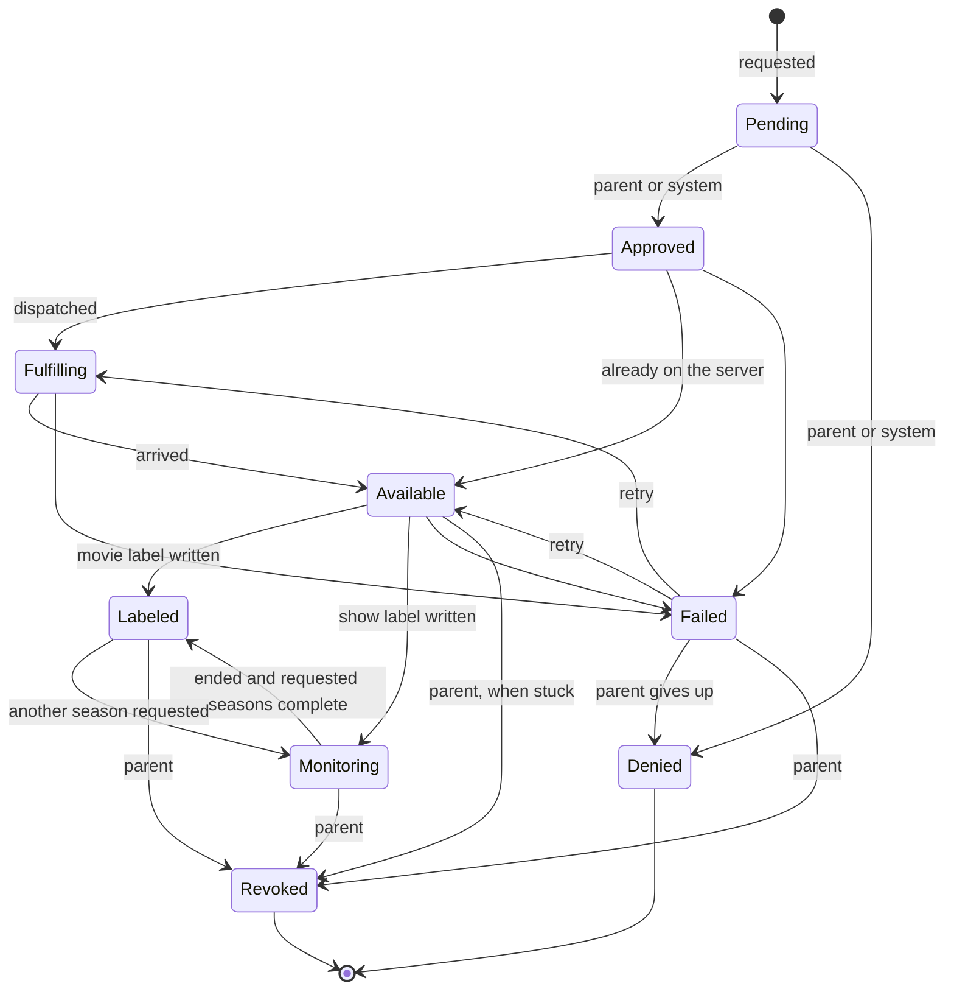

# Requests

A request is a kid profile asking for a movie or show. Requests are stored in the `MediaRequests` table and every change of state is recorded in `MediaRequestEvents`. `MediaRequests` in `Wishlistarr.Api.Requests` creates requests and moves them between states; the transition table itself is `RequestStateMachine` in `Wishlistarr.Core.Requests` and does no I/O. Kids ask for titles through `POST /api/v1/kid/requests` (see [Asking for a title](#asking-for-a-title)) and see their own list through `GET /api/v1/kid/requests` and the wishlist with the weekly allowance left through `GET /api/v1/kid/wishlist` (see [Kid wishlist](#kid-wishlist)). Parents see what is waiting, and why, through `GET /api/v1/requests/queue` (see [Approval queue](#approval-queue)).

## States



| State | Meaning |
| --- | --- |
| `Pending` | Waiting for a decision. |
| `Approved` | Allowed, not yet sent anywhere. |
| `Denied` | Turned down. |
| `Fulfilling` | Sent off to be downloaded. |
| `Available` | On the media server. |
| `Labeled` | The kid's Plex label is on the item; requested seasons of an ended show are complete. |
| `Monitoring` | The show label is on Plex; season availability continues to be checked. |
| `Failed` | Dispatch, arrival or labeling went wrong. |
| `Revoked` | A parent took the app's label back. The title stays in the history. |

`Denied` and `Revoked` are final. `Labeled` and `Monitoring` are not: a parent can revoke either. A parent can also revoke a `Failed` request, because labeling has finished before a request is marked `Failed`, and an `Available` request that has been stuck there for longer than `Approval:StuckAfter`. An `Available` request inside that time is not revoked, because its label may still be being written. See [Granting and revoking](#granting-and-revoking).

## Actors

Every change is made by an actor: a `Kid` (with the kid profile id), a `Parent` (with the parent account id, or none for the API key) or the `System` (with the name of the component, such as `dispatch`). Each transition lists who may make it:

| From | To | Actors |
| --- | --- | --- |
| `Pending` | `Approved`, `Denied` | Parent, System |
| `Approved` | `Fulfilling`, `Available`, `Failed` | System |
| `Fulfilling` | `Available`, `Failed` | System |
| `Available` | `Labeled`, `Monitoring`, `Failed` | System |
| `Monitoring` | `Labeled` | System |
| `Monitoring` | `Revoked` | Parent |
| `Labeled` | `Monitoring` | System |
| `Available` | `Revoked` | Parent |
| `Labeled` | `Revoked` | Parent |
| `Failed` | `Fulfilling`, `Available` | Parent, System |
| `Failed` | `Denied`, `Revoked` | Parent |

The System may approve or deny so that content policy can decide a request without a parent. Kids can create requests for their own profile and cannot move them. Parents and the System can create requests for any active profile.

## Transitions

`TransitionAsync(requestId, to, actor, reason)` returns one of:

- `Changed`: the state moved and an event was stored.
- `Unchanged`: the request was already in that state. Nothing is stored, so repeating a transition is safe.
- `Rejected`: the transition is not in the table, or the actor may not make it. The request is left as it was.
- `NotFound`: there is no such request.

The state change and its event are saved together. Each request has a `Version` that is checked and bumped on every change, so when two writers race only one wins; the other reads the request again and is decided against its new state, which usually makes it `Unchanged` or `Rejected`.

`RetryAsync(requestId, actor, reason)` moves a failed request back to the step that failed: `Available` if labeling failed, otherwise `Fulfilling`. Retrying a request that has already been retried is `Unchanged`.

## Duplicates

A kid can only have one open request per title. Titles are identified by kind (`Movie` or `Show`) and TMDB id, like the content policy's `TitleKey`. `CreateAsync` for a title the profile already has a request for, in any state but `Denied` or `Revoked`, returns `Merged` with the existing request instead of creating another, and bumps its `RequestCount` and `LastRequestedAt`. A duplicate selection is not a transition and stores no event. Requesting an additional season of a completed show moves it back to `Monitoring` and records that transition. A parent grant creates its request with merging turned off: when the profile already has an open request for the title, `CreateAsync` returns `Unchanged` with that request and changes nothing on it.

Once a request is denied or revoked, asking again starts a new `Pending` request; the closed one stays in the history. A unique index on profile, kind and TMDB id (ignoring denied and revoked requests) keeps this true when two requests arrive at once. A title that has been revoked is not decided by the content policy or an auto-approve rule the next time the kid asks: it waits for a parent. See [Granting and revoking](#granting-and-revoking).

## TV seasons and show access

A show request may include `seasons`, for example `{ "kind": "show", "tmdbId": 82728, "seasons": [2] }`. Each number must be distinct, non-negative and listed in TMDB's show details; season `0` selects specials. An empty list, a movie with seasons or a season that is not listed returns `400`. Omitting `seasons` uses the backend's all-season behavior: Sonarr excludes specials, while Seerr's handling depends on its version and specials setting (see [Seerr](seerr.md#requests)). Explicit season `0` selects specials when the backend permits them. The kid title screen sends its chosen season. Search cards may still request all seasons.

Each show stores its season selections separately from availability observations. Request lists, title details and the parent queue include `seasons`: `{ number, availability, availableEpisodes, requested }`. `requested` means the kid explicitly selected that season. The arrival check reads Plex show children and compares their `index` and `leafCount` with TMDB's expected episode counts. `missing` means no episodes, `partial` means fewer than the expected number, `available` means at least the expected count, and `unknown` means episodes exist but no positive expected count is known. One season arriving never marks all the other seasons available. Copies may overlap, so the largest count from a single copy is used rather than adding duplicates together. Counts can be conservative when episodes are split between copies or Plex and TMDB use different episode ordering.

The labels are on the **show**, so approval grants every season already in Plex and future seasons too. Season selection controls downloads, never Plex authorization. Both parent approval views explain this before the approve button. Revoking a monitored show removes its owned show labels and stops arrival checks, as for any labeled title. A parent grant only grants access and never starts a download, including after an upgrade. A later kid request can turn that access-only record into a download request: an omitted season list requests all seasons, while an explicit list starts with those selected seasons rather than inheriting the grant's show-wide scope.

A labeled show enters `Monitoring`, including when all currently requested episodes are present. Only an `Ended` or `Canceled` show whose requested seasons are complete moves to `Labeled`; an unknown production status keeps monitoring. The existing five-minute arrival job continues checking monitored shows without a new webhook. TMDB details use the existing 12-hour memory cache; production status and expected counts are not copied to request records. Plex observations and season selections (including seasons covered by an all-season request) are retained as request history. Other unselected TMDB seasons are not copied into request records.

A kid can request another listed season of an approved show. The request merges into the same title, the content policy still runs, and the download service receives the selected seasons. The existing show approval covers these downloads because it already granted the whole show. Duplicate selections do not dispatch again. The show stays `Monitoring` and remains revocable while the new season downloads. An ended show returns from `Labeled` to `Monitoring` for a new selection. Previously revoked shows still create a new `Pending` request that requires a parent decision. New seasons appear in the title details and remain selectable. For an all-season request, polling also records seasons covered by that request; discovery by itself is not a new explicit selection.

A monitored request with an unsent selection is retried by the dispatch job. A service outage preserves the show access and its monitoring state; no success is recorded until the backend accepts the season request. Missing service configuration waits for configuration. Sonarr receives the requested season numbers and Seerr receives an explicit season array, or its `all` value when seasons were omitted. These follow the existing integration clients' merge and idempotency behavior.

The parent request list accepts `includeMonitoring=true` with `state=labeled` to page completed and monitored show access together. `state=monitoring` selects only monitored requests. Pagination totals include exactly the selected states.

## History

Each `MediaRequestEvents` row holds the request id, the state before (empty for the creation) and after, the actor's kind, id and name, an optional reason of up to 500 characters and the time it happened. Rows are only ever added. `GetHistoryAsync(requestId)` returns them oldest first.

Parents can read one profile's events, newest first, with `GET /api/v1/kid-profiles/{id}/events`. `limit` defaults to 50 and is capped at 200. Archived profiles are included. A missing profile is `404`. Each item is `{ id, requestId, kind, tmdbId, title, fromState, toState, actorKind, actorName, reason, occurredAt }`. It does not include a PIN. A kid session cannot call it. See [health.md](health.md).

## Asking for a title

`POST /api/v1/kid/requests` needs a Kid session and the antiforgery token, and takes `{ kind, tmdbId }` where `kind` is `movie` or `show`. `KidRequestFlow` in `Wishlistarr.Api.Requests` handles it in this order:

1. The title's name, genres, original language and US certification are read from TMDB. When the profile blocks keywords, the title's keywords are read too (`keywords` on a movie, `results` on a show). The content policy is then evaluated for the profile. Nothing is looked up in Plex and no label is written before this. A keyword lookup that fails or times out refuses the request. A lookup that returns no keywords is not a match. A profile with no keyword blocks does not call the keywords endpoint.
2. A `Blocked` title is turned away with `422` and a message meant for a kid (`"That one isn't available."`, `code: "notAllowed"`). The rating, genre, keyword, language and the reason are not shown to the kid; the reason code is written to the log. No request is stored.
3. An `Allowed` title is looked for in the library by its TMDB id. If it is there, the request is created and moved by the System (`instant-label`) through `Approved` to `Available`, then the profile's Plex label is added to every matching item with the label writer (source `request`) and the request becomes `Labeled` for a movie or `Monitoring` for a show. Labeling itself does not start a download. A monitored show may subsequently download missing selected seasons while remaining in `Monitoring`. If Plex will not take the label, or the item has gone, the request becomes `Failed` and can be retried. A label already added to another copy is taken off again first (see [Approving and denying](#approving-and-denying)).
4. An auto-approve rule can decide the rest without a parent. It uses the same approval path as a parent, and the actor is the system (`auto-approve`). See [Auto-approve](#auto-approve).
5. Anything the rule does not approve stays `Pending`: titles that need approval, including every unrated title, even when they are already in the library (they are not labeled until a parent approves), and allowed titles that are not in the library and that the rule does not approve.

A new request answers `201` and asking again for a title that already has a request answers `200`; both return `{ id, kind, tmdbId, title, state, requestCount }`. Unknown titles answer `404`, and when TMDB cannot be reached the answer is `502` (or `503` without an API key) with a message that is safe to show a kid.

The title screen shows the open request and asks through this same endpoint (see [Title details](title-details.md)). A kid cannot move a request to another state. Choosing a season sends that selection for download; access remains for the whole show.

### Library lookup

The library is checked through `LibraryLookup`, which asks each registered `ILibraryIndex` first. An index returns the matching items, or `null` when it cannot answer yet, for example before its first sync. With no index, or when none can answer, the flow falls back to a live lookup on the Plex server (`IMediaServer.FindByExternalIdAsync`). If Plex is not connected or cannot be reached, the title is treated as not in the library, so it becomes a pending request and is never labeled.

### Double submission

Asking twice for the same title gives one request: the second ask is a merge (see [Duplicates](#duplicates)), it bumps `requestCount` and does not label again. Allowance checks, the duplicate check and the creation of the request run in one database transaction, and SQLite lets only one such transaction write at a time, so taps that arrive together are handled one after the other.

### Weekly allowance

A profile's `weeklyAllowance` limits how many new requests it can make in a week. Without one there is no limit; `0` means no new requests.

- Weeks start on Monday at midnight in the parent's time zone. Set it with the `parent.time_zone` setting to an IANA name such as `America/Chicago` (`PUT /api/v1/settings/parent.time_zone`; unknown names are rejected). Without the setting the server's time zone is used. When a clock change skips midnight the week starts at the first time that exists, and when midnight happens twice it starts at the first one.
- Every new request the kid creates counts once, whatever happens to it later, including denied ones.
- Instant labels do not count and are not blocked by the allowance: the title is already on the server and the policy allowed it, so no parent has to act. A show and its additional season selections share one title request; missing selected seasons may still be downloaded.
- Asking again for a title that already has a request does not count.
- A request over the allowance is answered with `429`, `code: "allowanceUsed"` and `resetsAt`, the start of the next week. Nothing is stored.

Each request stores whether it counts in `CountsTowardAllowance`, so the rule that applied when it was made is kept.

## Approving and denying

Parents decide pending requests. A kid session cannot.

- `GET /api/v1/requests` lists requests in id order, one page at a time, as `{ items, total, limit, offset, unfinished }`. `?state=pending` (or any other state name) limits the list. A number is not a state name. `limit` is 1 to 200 (default 50) and `offset` is 0 or more; anything else is rejected with `400`. `total` counts every request that matches the state and has a kid profile, the same rows the list can return, so a client can tell when more remain. Each item has `canRevoke`: true for a `Labeled` or `Monitoring` request, for a `Failed` request when the ownership ledger still holds a label for the profile on one of the title's copies, and for an `Available` request that has been there for longer than `Approval:StuckAfter`. For the failed requests on a page, `canRevoke` comes from one read of the library index and one ledger query, matched by server, Plex guid and profile; it never calls Plex. Until the index has finished its first full sync it cannot answer, and every failed request has `canRevoke` false. Each item also has `labelMayRemain`: true for a `Failed` request whose label write timed out or threw, because Plex may have applied it anyway, and for an `Available` request that counts as stuck. Each item has `canRetry`, true for a `Failed` request that failed while being sent (see [Dispatching](#dispatching)), and `dispatchFailure`, `notConfigured` or `unavailable` for such a request and otherwise null. The page has `unfinished`, the number of `Failed` requests plus the `Available` requests that count as stuck, whatever `state` asked for, so the parent page can show that section without loading it. The count and the page are read in one transaction. Titles are resolved once per page, not once per row.
- `POST /api/v1/requests/approve` and `POST /api/v1/requests/deny` take `{ ids, reason }`. `ids` is required, from 1 to 50 positive ids. `reason` is optional. The web app sends a longer selection as several calls of at most 50 and lists every item that did not succeed.

Both writes need the Parent role and, for a session cookie or the trusted-network bypass, the antiforgery token. An API key does not send one. Each id comes back on its own in `{ results: [{ id, status, state }] }`. `status` is one of:

| Status | Meaning |
| --- | --- |
| `succeeded` | This call applied the decision. |
| `alreadyDecided` | The request was already approved (or further along) for an approve call, or already denied for a deny call. Nothing was written. |
| `notFound` | There is no such request. |
| `notProcessed` | The call ran past its overall deadline before this id was reached. Nothing was written for it; send it again. |
| `failed` | The decision could not be applied. The request is left as it was, except when labeling an in-library title fails for any reason: that request moves to `Failed`. |
| `conflict` | The request was no longer pending because someone chose the other outcome, or it had already failed. A deny only applies to a request that is still pending, so it cannot take a failed approval. |

A batch that is empty, too long, or contains an id that is not positive is rejected with `400` and nothing is changed. The same is true of a reason that is longer than 500 characters after trimming. Calling either endpoint again is safe: a request that was already given that decision is `alreadyDecided`, and a label is not written a second time.

Approving a title the library lookup does not find moves it from `Pending` to `Approved` and stops. A background job then sends it to its download service (see [Dispatching](#dispatching)). Approving a title the lookup finds moves it to `Approved`, then `Available`, writes the profile's Plex label through the label writer and the ownership ledger (source `request`), and then moves it to `Labeled` for a movie or `Monitoring` for a show. If the label cannot be written, or the item has gone, or the label writer fails in any other way, the request moves to `Failed` instead of `Labeled`; a failure that the application can see never leaves it at `Available`. Writing the label has a deadline of `Approval:LabelTimeout` (default 30 seconds); a Plex call that does not answer in time ends that request as `Failed` with the reason `Plex did not answer in time.`. A call with many ids also has an overall deadline, `Approval:BulkTimeout` (default 5 minutes, never shorter than `LabelTimeout`). Ids not reached by then come back as `notProcessed` and stay as they were. A third value, `Approval:StuckAfter` (default 10 minutes), is how long a request has to sit at `Available` before a parent can revoke it. It must be at least twice `LabelTimeout`, because a labeler can spend one `LabelTimeout` writing labels and another taking them off again after a failure. All three are set under the `Approval` configuration section as `hh:mm:ss` values. `LabelTimeout` is at most 10 minutes and `BulkTimeout` at most 24 hours, and the application will not start if a value is invalid. The moves after `Approved` are not tied to the caller's connection, so a caller that disconnects cannot leave an in-library title at `Approved`. Instant labels use the same labeling code. It never goes to `Fulfilling`.

The ownership row is saved before the label is sent to Plex, in its own save that the deadline cannot cancel. If Plex rejects the write, the row is removed again. If the deadline fires while Plex is answering, the row stays, so a label that Plex did apply is always owned and can be removed later. The reverse can happen: a `Failed` request from a timeout may have a label in Plex, or a row for a label Plex never applied, and removing it later reports the label as not present and clears the row. A label that was already on the item before the request is never given a row.

A title can have more than one copy in the library, and the label goes on each of them in turn. If a later copy fails, for any of the reasons above, the labels this attempt added to earlier copies are removed again before the request moves to `Failed`, so a failed request normally leaves no label of its own behind. A label that was already on a copy before the attempt is not touched. If removing one of them fails too, that label stays on the copy with its ledger row, the error is logged, and the parent page offers to revoke the failed request, which removes it. The copy whose own write failed is handled by the label writer: if Plex rejected the write, its new row is removed again; if Plex did not answer in time, the row stays whether or not the label arrived, and the parent page offers to revoke the failed request, which removes the label or clears the row. One case is still open: a write that Plex applied but that then failed with an error other than the deadline (for example a dropped connection while Plex was answering, or a label Plex took but did not lock) has its new row removed, so the label stays in Plex with no row. The app treats such a label as one it did not apply and a revoke leaves it. The parent page lists failed requests under **Did not finish**, and says for each one whose write timed out or threw that a label may have been left in Plex: with a revoke button when the ledger has a row for it, and otherwise with a note to check the labels on the title in Plex.

Labeling, revoking and the labeling part of a grant take a lock for the request, so for one request only one of them runs at a time in the application. Labeling checks that the request is still `Available` once it holds the lock and writes nothing otherwise. Waiting for the lock ends when the caller goes away. For labeling, the request is already `Available` by then, so it moves to `Failed` with the reason `Labeling was stopped before it started.` and no label is written.

For an approval that found the title already in the library, one gap remains. If the database fails or the process stops after the request was moved to `Available` and before the final move to `Labeled` or `Failed`, the request stays at `Available` and nothing moves it on its own. There is no automatic repair for these requests, which were never dispatched. The title is in the library, and the Plex label may or may not have been written. Once the request has been at `Available` for longer than `Approval:StuckAfter`, the parent list marks it with `canRevoke` and the parent page offers to revoke it. That removes any labels the ledger shows for the profile on the title's copies and moves the request to `Revoked`. Granting it again in the meantime is `409`.

The library lookup is the same one requests already use. A ready library index answers, and an empty answer means the title is not in the library even if a live Plex scan would find it. An index that cannot answer yet falls back to Plex. If the lookup throws, the approval fails and the request stays `Pending`: nothing is labeled and nothing is marked approved.

The `Pending` to `Approved` or `Denied` event records who acted. A signed-in parent is stored with the account id and username. An API key is stored as a parent named `API key` with no account id, and a trusted-network caller as a parent named `Trusted network` with no account id, which is how those callers already sign in. Later steps (`Available`, `Labeled`, `Monitoring`, `Failed`) are the system (`approval`), unless the actor was already the system. Two decisions for the same request cannot both succeed. The request version lets one save win; the other comes back as `alreadyDecided` or `conflict`, and only the winner labels.

## Dispatching

An approved request is sent to the service it was approved with. `fulfilment.mode` (`PUT /api/v1/settings/fulfilment.mode`) is `seerr`, `arr` (Radarr for movies, Sonarr for shows) or `none`; anything else is rejected with `400`. With no value the mode is `none`.

- **The service is stored per request.** The `Pending` to `Approved` move stores the mode on the request (`Backend`). Changing the mode later affects only requests approved afterwards, so a request that is already in flight, or failed, is retried against the service it was approved with. A request approved while the mode was `none` has no service yet and takes the mode in force the first time the job looks at it. That includes requests that were already `Approved` before dispatching existed: after an upgrade they are sent as soon as a mode other than `none` is set.
- **The job.** The `request-dispatch` job (see [jobs.md](jobs.md)) is started right after an approval or a retry and also runs every minute, which picks up anything that was interrupted. It sends every `Approved` request, and every `Fulfilling` request that has not been sent yet, which is a failed one that was retried (a retry clears `DispatchedAt` so the request is sent again, and the check for an existing title keeps that from adding it twice). A show sends its selected season numbers; when seasons were omitted Seerr gets `"seasons": "all"` and Sonarr every season but specials. On success the request records the service's id (`ExternalId`, the Seerr request id or the Sonarr or Radarr id when there is one) and `DispatchedAt`, and moves from `Approved` to `Fulfilling` as the system (`dispatch`).
- **Retries are safe.** A send always asks the service first whether it already has the title and only then adds it: Seerr attaches an existing request (see [seerr.md](seerr.md)) and Sonarr and Radarr reuse a title they already list and treat their "already been added" answer as a match (see [sonarr-radarr.md](sonarr-radarr.md)). A send whose answer was lost, or a process that stopped after the title was added and before the request was saved, is therefore found again by the next attempt and never adds the title twice. The request stays `Approved` until the send is recorded.
- **Failures.** A send that fails, because the service is not set up, cannot be reached, refuses the request or returns something unexpected, moves the request to `Failed` as the system (`dispatch`). The event reason is one of two fixed sentences, `The download service is not set up.` or `The download service did not accept the request.`, never the service's own answer, its address or a key. The details are in the application log. A kid sees a failed request as waiting, as before.
- **Retrying.** `POST /api/v1/requests/retry` takes `{ ids, reason }` like deny and revoke (1 to 50 positive ids, an optional reason of at most 500 characters) and returns `{ results: [{ id, status, state }] }`. It needs the Parent role and, for a session cookie or the trusted-network bypass, the antiforgery token; a kid session is rejected. A `Failed` request that failed while being sent moves to `Fulfilling` and the job is started, so `succeeded` means it was queued to be sent again. A request that is already `Approved` or `Fulfilling` is `alreadyDecided`, so repeating a retry is safe. Anything else is `conflict`, including a request that failed while its Plex label was written, which is revoked instead, and a missing request is `notFound`. The parent page shows the reason next to each failed request with a button to try again.

## Arrival and labeling

The `request-arrival` [job](jobs.md) runs every five minutes for dispatched requests and monitored shows belonging to active profiles. It refreshes the Plex library index before matching by media kind and TMDB id. A title reported as downloaded by Sonarr, Radarr or Seerr stays on its way until Plex can return the item. Names are never used for matching. Legacy Plex agent guids are resolved through the index's [TVDB and IMDb lookup](library.md#legacy-agent-items).

Before granting access, the job reads each matching item from Plex and checks that its guid and external ids still describe the indexed title. Missing or rematched items are skipped. The expected server, rating key, guid, kind, library and external ids also follow the item into the label writer, which checks them while holding the item lock and during its confirmation reads. A rematch detected before the write fails the label operation without applying the profile's label to the replacement.

Plex has no conditional write, so an external change after the last confirmation can still race with the write. If a rematch is detected by the verification read after Plex accepted the label, the request becomes `Failed`, but the label can remain on the rematched item and the ownership ledger can retain the original guid. The writer does not remove a label from a changed identity automatically. Normal revoke may then fail to find the requested title, or leave the label alone because the replacement's guid has no matching ownership record. This case needs manual investigation in Plex; revoking the request does not guarantee label cleanup after a rematch.

A visible title moves to `Available`, receives the profile's Plex label through the existing label writer and ownership ledger, then moves to `Labeled` for a movie or `Monitoring` for a show. Every matching copy is labeled. A repeated notification or poll leaves a labeled request alone. If the application stops between the available transition and labeling, the next check finishes it without another available event. A label-write failure uses the existing failed state. Where the title and ownership can still be matched, a parent can revoke it to remove owned labels and let the title be requested again; the usual protections for labels used by another active profile still apply.

Plex `library.new`, Sonarr and Radarr `Download`, and Seerr `MEDIA_AVAILABLE` [webhooks](webhooks.md) start the same arrival check immediately. They are hints to check Plex, not evidence of availability. An early or missed notification is recovered by polling. A Plex connection or lookup failure leaves the request on its way for another check; it does not mark the download failed. Checks use Plex to establish availability. A monitored show with an unsent season selection may start the separate dispatch job; already dispatched seasons are not sent again.

The interval and enabled state can be changed through `Jobs:Schedules:request-arrival`. A parent can also run it with `POST /api/v1/jobs/request-arrival/run`.

Each check also retries unresolved TVDB and IMDb mappings for the selected Plex server, independently of Plex's last-changed cursor. It reloads the unresolved items from Plex before resolving them, so a temporary TMDB lookup failure is recovered by a later poll even if Plex never changes the item again. Items without legacy ids need no lookup.

## Approval queue

`GET /api/v1/requests/queue` is for a parent. A kid session receives `403` and an anonymous caller receives `401`. The response sends `Cache-Control: private, no-store`, including when the call is rejected. It is not the parent list and it is not the kid title screen: the list stays a page of requests, and kid title details do not grow a `providers` field or a `reason`.

`kidProfileId` is optional. Left out, the queue is every pending request that still has a kid profile, including a profile that has been archived. `0` or a negative id is `400` with the title `The kid profile id must be a positive number.` A positive id that matches no profile is `404` with the title `The kid profile does not exist.` `limit` and `offset` are the same as the parent list (1 to 200, default 50, offset not negative) and a bad page is `400` with the same sentence, `The limit is 1 to 200 and the offset is not negative.`

The body is `{ items, total, limit, offset, tmdbConfigured }`. `tmdbConfigured` is `false` when no TMDB API key is saved and `true` otherwise. When it is `false` the queue makes no TMDB call and logs nothing per item: every item comes back with the stored title (empty when the stored name is older than the TMDB retention) and the gaps `synopsis`, `rating` and `providers` (plus `trailer` when trailers are on), the reason is `unavailable`, and approve and deny work as usual. The parent page shows one notice when the flag is false and does not repeat each card's gap sentences. `total` counts every pending request the filter matches, and `items` is that page in id order. The count, the page and the page's kid profiles with their blocked and always-allowed title lists are read in one deferred SQLite transaction, and that transaction is finished before any TMDB call. Titles on the page are then read at most 4 at a time (`RequestQueue.MaxParallelLookups`). Each TMDB call may take at most 5 seconds (`RequestQueue.CallLimit`), including any wait for a `429` retry, and the whole page may spend at most 12 seconds on TMDB (`RequestQueue.PageBudget`). A call that runs over its limit counts as a failed read. Once the page budget is spent, calls in flight are stopped, no further TMDB call is made, and the remaining items come back with their gaps, so a slow or rate-limited TMDB never stops the queue from loading or a parent from deciding. Whatever an item already had when the budget ran out (the details and the certification) is kept and shown, and only the parts that were not read are gaps; the reason for such an item stays `unavailable`, because a decision that was not completed is not trusted. The budget running out is logged once per page as a warning and the items it skipped are not logged one by one; a real TMDB failure for an item is still logged. A caller that disconnects cancels everything, and that is not reported as gaps. A stored title name that is older than the TMDB retention is replaced with the name from the details read for the item; when that read fails the title is empty. Details, videos, watch providers and keywords use the TMDB response cache (12 hours); certifications use it for 7 days. A failed read is not cached.

Each item has `id`, `kidProfileId`, `kidName`, `kind` (`movie` or `show`), `tmdbId`, `title`, `requestCount`, `createdAt`, `overview`, `rating`, `descriptors`, `providers`, `trailerKey`, `reason` and `gaps`. `overview` is the same synopsis as a kid title, cut at 2000 characters. `rating` is the US certification text, and `descriptors` are that certification's descriptors with surrounding space removed and repeats dropped. `providers` is `{ name }` only: US subscription (`flatrate`) names, in the order TMDB already sorted them, with blank names skipped and the same name kept once (the first spelling wins). There is no provider id, logo, link, rent or buy list, and no JustWatch URL. `trailerKey` uses the same choice as kid title details. When `kids.youtube_trailers` is not exactly `true`, videos are not requested and `trailerKey` is null.

`reason` is decided again from the profile as it is now, plus whether this profile already has a revoked request for the same kind and TMDB id. It comes from the same evaluator, with the same profile rules and per-title lists, that decides a kid's request and the parent's policy preview, so the queue and the preview cannot disagree. It is not a copy of an earlier decision, and the queue does not ask the library or Plex. `code` is one of:

| Code | When |
| --- | --- |
| `revokedBefore` | A revoked request already exists for this profile and title. This wins over the current policy, except an explicit block and a title whose information could not be checked. |
| `unrated` | The policy needs a parent because there is no usable US rating, or auto-approve would skip the title for that reason. |
| `unknownGenres` | The profile blocks genres and this title's genres could not be checked, or auto-approve would skip it for that reason. |
| `aboveRatingLimit` | The policy blocks the title for its rating. |
| `blockedGenre` | The policy blocks one of the title's genres. |
| `blockedKeyword` | The policy blocks one of the title's keywords. |
| `languageNotAllowed` | The original language is not one the profile allows. |
| `explicitlyBlocked` | The title is on the profile's blocked list. This wins over an earlier revocation. |
| `aboveCeiling` | The title is allowed, and its rating is above the auto-approve ceiling for this kind. |
| `autoApproveOff` | The title is allowed, and the profile's auto-approve switch is off. |
| `notAutoApproved` | The title is allowed and auto-approve would take it, but this request is still pending. |
| `unavailable` | The reason could not be checked, TMDB marks the title as adult, or the block is one the queue does not name. The preview reports `MetadataUnavailable` for the same cases. |

`rating`, `level`, `maxLevel`, `genreName`, `keywordName` and `language` go with the code. `maxLevel` is set only for `aboveCeiling` (that kind's ceiling) and `aboveRatingLimit`. A title on the profile's always-allowed list is never `aboveRatingLimit`; it gets the auto-approve reason, such as `autoApproveOff` or `aboveCeiling`. `genreName` and `keywordName` are filled when the id matches the details or the keyword list. A profile that blocks keywords and whose keyword list cannot be read gets `unavailable` and the gap `keywords`; the synopsis, rating and providers from the calls that succeeded stay. A title TMDB marks as adult gets `unavailable` with no synopsis, rating or providers, and no gap. The parent page turns these codes into sentences and shows `unavailable` for a code it does not know, so the rest of the card can still be decided. A gap name it does not know is left off the card, and the queue still loads. The `keywords` gap is shown in its own sentence.

`gaps` names what could not be read: `synopsis`, `rating`, `providers`, `trailer`, `keywords`. A details failure, including a title the page budget did not reach, sets synopsis, rating and providers, and trailer as well when trailers are on, and skips the later calls. A keyword failure sets `keywords`. A certification failure sets `rating` and makes the reason `unavailable`. A provider failure sets `providers` and leaves `providers` empty; the rest of the item stays. An empty US subscription list is a success, not a gap. A video list with no usable trailer is a success when the list was read. Cancelling the call is not a gap.

The parent home, at the top of `/parent`, loads the first page and shows one card per pending request: the synopsis, the rating and its descriptors, the streaming names with the JustWatch credit from `WatchProviders`, the trailer (the same click-to-play player as a kid title, and no player when the setting is off or the key is not a YouTube id), the sentence for `reason`, and a sentence when the keyword list could not be loaded. When `tmdbConfigured` is false, one notice at the top of the queue says that TMDB is not configured, and the gap sentences stay off the cards. The cards can still be approved or denied. A queue body with no `tmdbConfigured` field is treated as configured. Approve and deny each send one call to the existing approve and deny endpoints, for that one id. Approve sends `reason: null` even if a note is typed. Deny sends the note with surrounding space removed, or `null` when it is blank, and a note longer than 500 characters is not sent. After a decision that removes the card, focus moves to the next request's approve button, skipping a request that is still being decided, or to the previous ready button when the decided request was last. When every request still on screen is being decided, focus moves to the kid filter. When none remain and `total` is zero, focus moves to the empty state. When the cards on screen have all been decided and `total` is still greater, the home loads the next page on its own and moves focus to that page's first approve button, to the load button when that page is still empty and more remain, to the empty state when none remain, or to the load error if the page fails. The empty line is not shown while `total` says more requests exist. A page that arrives empty while `total` is greater says how many more are waiting and offers a button to load them. The next button is taken from the queue as it stands when the answer arrives, so two decisions at once do not focus a card that has already gone or a button that is still waiting. A decision the server did not apply leaves the card in place and moves focus to the error. Choosing a kid sends `kidProfileId` and loads that kid's first page again. All kids leaves `kidProfileId` out. The count and the line about how many more are waiting come from the page that came back. The filter stays usable while that page loads. The selected kid stays in the filter when the profile list cannot be loaded, while that kid's page is loading, and when that kid has nothing waiting. The empty line then names that kid. A failed load shows that error. A page that arrives for a kid who is no longer selected is ignored. A request approved or denied while a page is loading is left out of the page that arrives, and off a page already showing it, so the card does not stay listed. When `total` is larger than the page and cards are still on screen, the home says how many more are waiting and links to the full request list. Recent activity is the profile event list, five events per kid, and the filter limits that to the selected kid. Quick actions jump to the request list, profiles, devices, history, backups, logs and the trailer setting. The trailer heading is on the page while that setting loads. The home is one column, with tap targets at least `--tap-size` and no horizontal scrolling.

## Denial reasons

`reason` is trimmed. A blank reason is stored as nothing. Otherwise it is stored as plain text on the `Pending` to `Denied` event, up to 500 characters, and it is not interpreted as HTML. The kid sees it only from `GET /api/v1/kid/requests`, and only on that kid's own denied requests, as `denialReason`. Other states omit it, including a failed request, so a labeling error is not shown to the kid. The list has no actor name and no other profile's requests. The parent list can include the same text.

## Auto-approve

Each profile has a switch, `autoApprove`, and an optional movie ceiling and TV ceiling (`autoApproveMovieRating`, `autoApproveTvRating`). The ceilings are rating levels (`preschool`, `general`, `children`, `parentalGuidance`, `teen`, `mature`, `adult`). A missing ceiling is no ceiling. Anything else is rejected. See [kid profiles](kid-profiles.md) for how they are saved, and [content policy](content-policy.md) for how a level relates to a certification.

Auto-approve never approves a title without a known rating. An unrated title always stays `Pending` for a parent, whatever the switch or the ceilings say and whether or not the title is already in the library. A ceiling, when set, always caps auto-approval, whether or not the switch is on, and movies and TV have separate ceilings. With the switch on and no ceiling for that kind, every title the content policy allows and that has a known rating is approved. With a ceiling, such a title is approved only when its rating level is at or below the ceiling for its kind. With the switch off, a ceiling alone approves under the same rule, and no ceiling approves nothing. A title the policy blocked or that needs approval for any other reason (such as a missing genre list when the profile blocks genres, or a language that is not listed) is not approved either: unknown does not count as allowed. When the library lookup fails, the rule does not approve and the request stays pending for a parent.

A title that is already in the library and allowed is labeled at once, as in [Asking for a title](#asking-for-a-title), so it does not count toward the weekly allowance. An auto-approved title that is not in the library counts like any other new request. Asking again for a title that already has a request does not approve it a second time.

## Granting and revoking

A parent can give a kid a title that is already in the library, and can take that access back. Both need the Parent role. A session cookie or the trusted-network bypass also needs the antiforgery token. An API key does not. A kid session is rejected.

`POST /api/v1/requests/grant` takes `{ kidProfileId, kind, tmdbId }`. `kind` is `movie` or `show`. The title's name is read from TMDB. It has to be in the library (the same lookup requests already use). A request is stored first, with the parent as the actor and the reason `Parent grant`, and the parent approves it. The profile's Plex label is then applied the same way an approval applies it, with source `grant` in the ownership ledger, and the request moves to `Labeled` for a movie or `Monitoring` for a show. The label goes on every copy of the title. If any copy fails, including one Plex will not keep the change on, the whole grant fails: the request moves to `Failed` and labels added to earlier copies are taken off again, as described in [Approving and denying](#approving-and-denying). It does not count toward the weekly allowance and it never downloads anything.

The response is `{ id, kidProfileId, kind, tmdbId, title, state, labelNotOwned }`. `labelNotOwned` is true when the profile's label was already on a copy and Wishlistarr did not put it there (for example, it was added by hand in Plex). That label is left alone: a later revoke does not remove it.

Granting does not ask the content policy for permission. A title the policy would block is still granted, and the history records that parent grant rather than a block. If the profile or title is missing (`404`), the title is not in the library (`422`), or TMDB or Plex cannot be reached before anything is stored (`502`), nothing is stored and no label is written. If the profile already has another open request for the title, such as a kid's pending request, the grant is `409` and that request is left alone with no label written. That is also true when the kid's request is stored at the same moment as the grant: the grant does not merge into it, so its `requestCount`, title and allowance flag are unchanged. If the label cannot be written after the request was stored, the response is `502` and the request is `Failed`. Labels added to other copies before the failure are removed again; if that removal fails too, those labels keep their ledger rows and revoking the failed request removes them. Granting the same title again picks a failed grant up and finishes it. A grant only labels a request it moved to `Available` itself. A grant that finds its request already `Available`, because another grant is still labeling it or labeling stopped part way, is `409` and writes nothing. Granting a title the profile already has a labeled request for returns that request (`200`) and does not write the label again.

`GET /api/v1/requests/grant/preview?kind=movie&tmdbId=603` looks a title up without changing any request or label, so the parent page can show its name before the parent confirms. Like every title lookup it may store the title's details in the title cache. It returns `{ kind, tmdbId, title, inLibrary }`. `inLibrary` is null when the library could not be checked. An unknown title is `404`.

`POST /api/v1/requests/revoke` takes `{ ids, reason }`, the same shape as deny, and returns `{ results: [{ id, status, state, labelNotOwned, labelInUse }] }`. A `Labeled`, `Monitoring` or `Failed` request can be revoked, and so can an `Available` request that has been stuck for longer than `Approval:StuckAfter`. For each one, Wishlistarr reads the ownership ledger rows for that profile and each copy of the title, matched by server, Plex guid and label (the same match the label writer uses), and removes only those labels. A label the app did not apply is left where it is, including a label another profile owns and a label someone added by hand in Plex. When the profile's label is still on a copy because the app did not apply it, `labelNotOwned` is true and the parent page says the label was left in place. A ledger row for an archived profile whose label is now the label of an active profile is not removed either, because that profile relies on the label: the label and its ledger row stay where they are, `labelInUse` is true, and the request is still marked `Revoked`. The request then moves to `Revoked` from the state it was in and the parent is recorded on that event. `reason` is optional, trimmed, stored as plain text up to 500 characters, and is not shown to the kid.

Revokes of the same request run one at a time, and the state is read again once the revoke holds the request lock. Waiting for that lock stops when the caller goes away, and nothing is removed. Once it holds the lock, the revoke no longer follows the caller, but reading and removing the labels in Plex has a deadline of `Approval:LabelTimeout`, and putting labels back has the same deadline again. If the title is not in the library, Plex cannot be reached or does not answer before the deadline, or a label the ledger owns cannot be removed, that id comes back as `failed`. A label whose removal did not finish counts as removed for putting it back, because Plex may have applied the removal. A label that is no longer in Plex while the ledger still has a row for it, such as one from a write that timed out before Plex applied it, counts as removed: the row is cleared and the revoke goes on. Any label already removed for it is put back, but only while the request is still in the state the revoke started from; a request that has moved on, for example to `Revoked`, never gets a label back. If the move to `Revoked` is rejected because the request changed, the id is `conflict`, with the same rule for putting labels back. If a label cannot be put back, the id is `failed`, the request keeps its state and the error is logged; that label and its ledger row are gone, and revoking again removes whatever labels are left. Revoking a request that is already revoked is `alreadyDecided`. Revoking a request in any other state, including `Pending`, `Approved` and an `Available` request that is not yet stuck, is `conflict` and removes nothing. Calling revoke again does not remove the label a second time. A request for an archived profile can still be revoked: its app-owned labels are removed the same way.

The API revokes any `Failed` request whose title is in the library, even when the ledger holds no label for it, so a revoke there removes nothing in Plex but still moves the request to `Revoked`. That has a lasting effect: the next time the kid asks for the title it waits for a parent, as described below. The parent page only offers revoke for a request whose `canRevoke` is true.

A kid can ask again for a revoked title. The new request is `Pending` and waits for a parent, whatever the content policy or an auto-approve rule would normally do, including a title the policy would block and a title that is already in the library. It counts toward the weekly allowance. The revoked request stays in the history. This is checked again inside the transaction that stores the request, so a revoke that lands while the kid is asking still leaves the new request waiting. A keyword lookup that fails still refuses the request, because an unknown title is not queued.

## Kid history

`GET /api/v1/kid/requests/history` needs a Kid session. It lists the signed-in profile's own request events, newest first, one page at a time: `limit` is 1 to 200 (default 50) and `offset` is not negative. Each entry is `{ id, requestId, kind, tmdbId, title, action, at, note }`. `action` is one of `granted`, `asked`, `approved`, `autoApproved`, `denied`, `ready`, `revoked` or `failed`. A parent grant is `granted` ("a parent added this") and a revocation is `revoked`. `approved` is a parent's yes. `autoApproved` is a yes from the system, such as an auto-approve rule or an allowed title that was already in the library, and is worded without mentioning a parent. `note` is the denial reason, and only on a denial. The parent's account id, username and the stored actor name are not included. Another profile's events are not included.

## Kid wishlist

`GET /api/v1/kid/wishlist` needs a Kid session. It answers for the signed-in profile only. There is no profile id to pass, and a query string is ignored. A kid never receives another profile's requests. A parent session is rejected with `403`, and a caller who is not signed in as a kid with `401`. The response is `Cache-Control: private, no-store`.

```json
{
  "remaining": 2,
  "resetsAt": "2026-10-26T05:00:00+00:00",
  "items": [
    {
      "id": 1,
      "kind": "movie",
      "tmdbId": 700,
      "title": "Movie 700",
      "state": "waiting",
      "note": null,
      "plex": null
    }
  ]
}
```

`remaining` is how many new requests the profile can still make this week, using the same week and the same `CountsTowardAllowance` count as [Weekly allowance](#weekly-allowance). It is `null` when the profile has no `weeklyAllowance` (no limit). `resetsAt` is the start of the next week when there is a limit, and `null` otherwise. `0` wishes left means the allowance is used up or was set to `0`.

Items are the profile's own requests, newest first. A request a parent has revoked is left out, because the title was taken off the kid's list. The [kid history](#kid-history) still says it was removed. The stored title is returned as text. Nothing is read from TMDB for this list.

### Friendly states

The internal state is not returned. Each item has one of four labels:

| Internal state | `state` | What the kid sees |
| --- | --- | --- |
| `Pending`, `Failed` | `waiting` | Waiting for a parent |
| `Approved`, `Fulfilling` | `onTheWay` | On its way |
| `Available`, `Labeled`, `Monitoring` | `ready` | Ready to watch |
| `Denied` | `denied` | Not this time |

`Failed` is shown as waiting for a parent because a parent is who can retry it or decide it is not this time. A state the server does not recognise is shown as `waiting`, so a request never disappears from the list. If the web app is given a `state` it does not know, it shows a neutral "Checking on it" badge.

### Denial note

When the request was denied by a parent, `note` is that parent's reason, trimmed, as plain text. The web app renders it as text and never as HTML. A denial by the system, a blank reason, or any reason on a request that is not denied is not included. Other event reasons, actor names, and the internal state are not in the response.

### Opening a ready title in Plex

A ready item has `plex` only when the selected server's machine identifier is known and the library index can name the item. The identifier and the rating key must be a short token of letters, digits, `_` and `-` (the same limits as the stored server id and rating key). If the index cannot answer yet, the item is not in the index, the lookup fails, or either value is not that shape, `plex` is `null`. The list does not ask Plex itself, and it never includes a server address or a token.

`plex.webUrl` opens the item in the hosted Plex Web app. [Opening Plex Web App](https://support.plex.tv/articles/200288666-opening-plex-web-app/) documents `https://app.plex.tv/desktop` as that app. The item path is the one Plex Web puts in the address bar, `#!/server/<machineIdentifier>/details?key=/library/metadata/<ratingKey>`, with the key percent-encoded so the whole thing is one URL. That shape is what the web app uses, as described in the Plex forum thread [Supported deep link to a specific library item's detail page](https://forums.plex.tv/t/supported-deep-link-to-a-specific-library-items-detail-page-on-android-mobile-and-windows-desktop/944608) (October 2026).

The link does not carry `X-Plex-Token` or the server's own address. It only works when the browser is signed in to a Plex account that can reach the server. The machine identifier is part of the link and is exposed to kids; it is not a secret. There is no link for the Plex apps, because the `plex://` links are not supported consistently and the desktop app does not take them.

The page uses the URL from this response as the link target. It accepts a link only when it starts with `https://app.plex.tv/`, and it drops one that contains `X-Plex-Token` or a `:32400` port. A ready title with no accepted link still shows "Ready to watch". The library lookups for all ready items in a list are made in one query.

### Keeping the list current

The kid home polls `GET /api/v1/kid/wishlist` every 15 seconds while the tab is visible. A failed load waits 30 seconds, then 60, and stays at 60 until a load works again. After the first load, a failed refresh keeps the list on screen and shows a notice with a retry button until a load works. A `401` or `403` stops polling and ends the kid session: the page calls `POST /api/v1/kid/signout` (a failure is ignored), resets the antiforgery token, clears the signed-in state and shows the profile picker. A profile that a parent archived is already rejected with `401` by the session check on every request, so a stale cookie cannot sign back in after a reload. The notice for a failed refresh is announced to screen readers, and a changed state is announced once and cleared a few seconds later so the same change can be announced again. While the tab is hidden the timer is cleared, and showing the tab loads the list at once. The page does not reload.

Polling is the fit for this app. The wishlist is one small JSON document behind the cookie session the kid already has, and a parent decision or a download is not second-critical. Server-sent events would hold a connection open, and nothing else in the API streams. Polling stops in the background and slows down when the server is unhappy, without a second way to authenticate.
